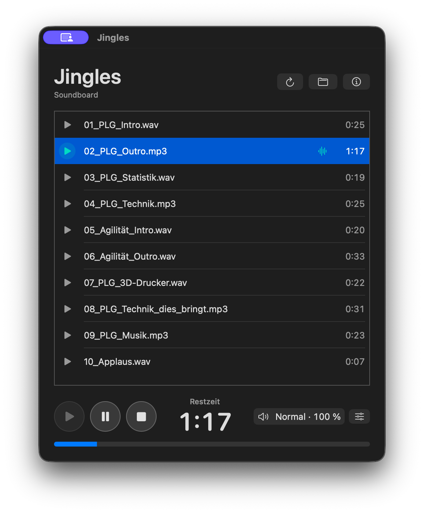
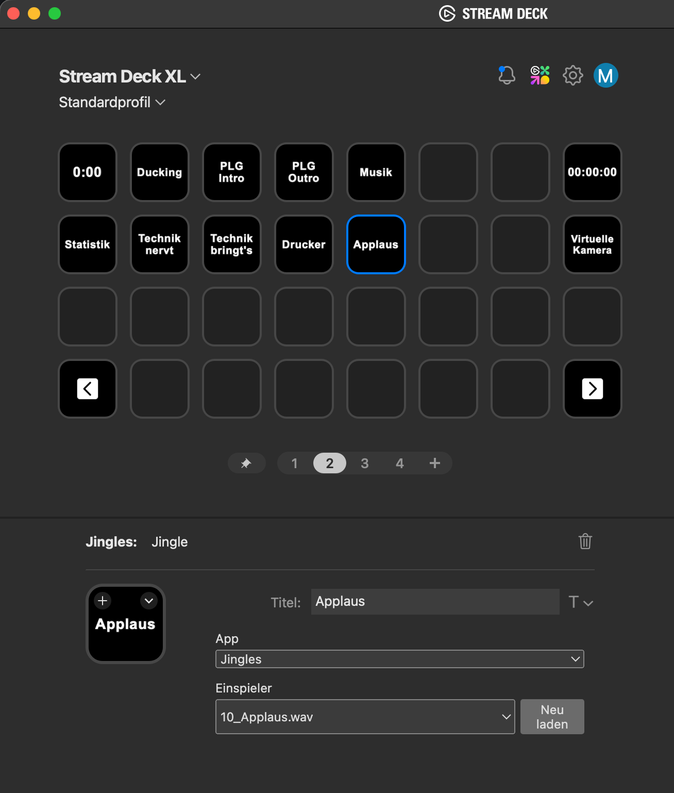

# Jingles

Jingles ist ein macOS-Soundboard für Podcasts und Live-Aufnahmen. Spiele WAV- und MP3-Dateien aus einem eigenen Ordner ab, steuere sie mit dem Stream Deck und zeichne sie in OBS auf einer eigenen Tonspur auf. Entstanden für den Podcast **Planlosgelöst**.

## Download und Installation

**[Jingles 0.5.5 für Apple-Chips herunterladen](https://github.com/maikpurrmann/jingles/releases/download/v0.5.5/Jingles-0.5.5-macos-arm64.zip)** · [Versionshinweise](https://github.com/maikpurrmann/jingles/releases/tag/v0.5.5)



Voraussetzung für den fertigen Download ist ein Mac mit Apple-Chip und macOS 13 Ventura oder neuer.

1. Die ZIP-Datei entpacken, `Jingles.app` in den gewünschten Programme-Ordner ziehen und öffnen. Bei einem Update zuerst Jingles beenden und die vorhandene App am bisherigen Ort ersetzen.
2. Über das Ordnersymbol einen Ordner mit WAV- oder MP3-Dateien auswählen. Jingles spielt über die aktuelle macOS-Tonausgabe.
3. Einen Einspieler über das Play-Symbol in seiner Zeile starten. Mit **Aktualisieren** liest Jingles den Ordner erneut ein.

Der Download ist lokal signiert und bislang ohne Apple-Notarisierung. Wenn macOS das Öffnen beim ersten Start blockiert, bietet **Systemeinstellungen → Datenschutz & Sicherheit** unter Umständen **Dennoch öffnen** an. Prüfe vorher, dass die ZIP von diesem Release stammt. [Apple zur ersten Freigabe](https://support.apple.com/en-us/102445#openanyway)

## Bedienung

- Ein Klick auf die Zeile wählt den nächsten Jingle vor. Die laufende Wiedergabe geht weiter. Die untere Play-Taste startet die Vorauswahl. Das Play-Symbol in der Zeile startet diese Datei von vorn.
- Der laufende Jingle hat ein türkises Play-Symbol und eine Wellenform. Die große Restzeit und der Fortschrittsbalken stehen bei den Wiedergabetasten. **Pause** hält die Position, **Stopp** setzt sie zurück.
- Der Prozentknopf schaltet den globalen Jingle-Pegel zwischen **100 %** und dem eingestellten Zielpegel um. Der Pegel gilt auch für den nächsten Einspieler. Über das Regler-Symbol lassen sich Zielpegel und beide Fade-Zeiten einstellen. Die Vorgaben sind **10 %**, **0,3 s** abwärts und **3,0 s** aufwärts.
- Über **ⓘ** findest du die Bedienhilfe sowie Version und Build-Datum.

Jingles spielt jeweils eine Datei. Eigene Einspieler bleiben in deinem Soundboard-Ordner. Unterordner werden beim Einlesen übersprungen.

### Darstellung

Ab Jingles 0.5.5 stehen im macOS-Menü **Darstellung** die Ansichten **Standard** und **Studio** zur Wahl. Jingles merkt sich die gewählte Ansicht. Du kannst auch während der Wiedergabe wechseln.

In **Studio** schaltet der orange Wippschalter in der Fade-Zeile die Pegelabsenkung um. Zielpegel, Fade runter und Fade hoch stellst du direkt an den drei Drehreglern ein, indem du sie nach oben oder unten ziehst. In **Standard** findest du dieselben Werte im Fade-Einstellmenü.

## Stream Deck

Jingles lässt sich direkt im App-Fenster bedienen. Für Aufnahmen mit dem Stream Deck ist das Plugin der empfohlene Einstieg. Es zeigt den laufenden Jingle, die Pegelabsenkung und auf Wunsch die Restzeit.

### Plugin einrichten

Du brauchst Jingles ab **0.5.0** und Stream Deck ab **7.1**. Lade das [Jingles-Plugin für Stream Deck](https://github.com/maikpurrmann/jingles/releases/download/v0.5.5/Jingles.streamDeckPlugin) und öffne die Datei per Doppelklick.

1. Jingles öffnen und den Einspielerordner wählen.
2. Im Stream Deck die Aktion **Jingles → Jingle** auf einen Tastenplatz ziehen. In den Einstellungen der Taste unter **Einspieler** die gewünschte Datei wählen. Für weitere Einspieler kannst du jeweils eine weitere Taste belegen.
3. Die Aktion **Jingles → Fade** auf einen Tastenplatz ziehen. Optional **Jingles → Restzeit** auf eine weitere Taste legen. Lass ihr Titelfeld frei, damit der Countdown angezeigt wird.



Das Beispiel aus **Planlosgelöst** zeigt die Taste **Applaus** mit ihrer Dateiauswahl. **Ducking** ist der eigene Titel für die Fade-Aktion. Die beiden rechten Tasten bedienen OBS.

Unter **App** ist bei allen drei Aktionen **Jingles** voreingestellt. Für einen Test mit dem separaten Vorschau-Build wählst du **Jingles Vorschau**.

Mit Jingles ab **0.5.4** und dem aktualisierten Plugin kannst du die Taste **Restzeit** auch zum Pausieren und Fortsetzen drücken. In der Pause bleibt die Zeit mit einem orangefarbenen Rand stehen. Bei `0:00` ohne Einspieler bleibt ein Tastendruck ohne Wirkung. Die vorhandene Tastenbelegung gilt weiter.

Die Einspieler-Taste ist standardmäßig mit **Jingle** beschriftet. Gib im Stream-Deck-Feld **Titel** deinen eigenen Namen ein. Der Titel bleibt beim Starten und Stoppen erhalten. Der grüne Rand zeigt an, welcher Jingle gerade spielt. Er läuft im Uhrzeigersinn ab und zeigt so den Wiedergabefortschritt. Ein weiterer Druck stoppt den Jingle.

In der Pause erlischt der grüne Rand. Ein Druck auf die Taste des pausierten Jingles startet ihn von vorn. Die **Restzeit**-Taste und der **Play/Pause**-Link setzen ihn an derselben Stelle fort.

Die schwarze **Fade**-Taste bekommt bei aktiver Pegelabsenkung einen orangefarbenen Rand. Eigene Titel wie **Ducking** bleiben beim Umschalten sichtbar. Die Anzeigen folgen auch Änderungen aus dem App-Fenster. Falls du eigene Tastenbilder gesetzt hast, setze sie auf die Plugin-Bilder zurück, damit die Ränder erscheinen.

Wenn in der Dateiauswahl ein neuer Einspieler fehlt, aktualisiere den Ordner in Jingles und klicke in den Tasteneinstellungen auf **Neu laden**.

### Vorhandene Tasten mit Steuerlinks

Die bisherigen Tasten mit lokalen HTTP-GET-Anfragen funktionieren weiterhin. Sie lösen Wiedergabe, Play/Pause oder Fade aus. Für die Statusanzeige belegst du die gewünschten Tasten mit den Plugin-Aktionen.

1. In Jingles den gewünschten Einspieler auswählen und in der Menüleiste **Stream Deck → Link für ausgewählten Jingle kopieren** wählen.
2. Im Stream Deck eine Aktion **System → Webseite** anlegen, den Link einfügen und **GET-Anfrage im Hintergrund** wählen.
3. Jingles geöffnet lassen. Ein Tastendruck startet die Datei, ein weiterer Druck stoppt sie. Eine andere Taste wechselt direkt zum nächsten Einspieler.

Im selben Menü findest du **Fade-Link kopieren**. Eine weitere Taste lässt sich mit dem Link für Play/Pause belegen.

| Aktion | Lokaler Link |
| --- | --- |
| Einspieler starten oder stoppen | `http://127.0.0.1:17639/play/<dateiname>` |
| Aktuellen Einspieler abspielen, pausieren oder fortsetzen | `http://127.0.0.1:17639/toggle` |
| Jingle-Pegel absenken oder anheben | `http://127.0.0.1:17639/fade` |

Die App erledigt beim Kopieren die URL-Kodierung des Dateinamens. Die Links gelten auf dem Mac, auf dem Jingles und Stream Deck laufen. Sie bleiben gültig, wenn du die Reihenfolge änderst oder eine Datei unter demselben Namen ersetzt. Nach dem Umbenennen einer Datei kopiere den Link erneut.

## OBS

1. Jingles öffnen. In OBS eine **macOS-Audioaufnahme** hinzufügen, **Anwendungsaudioaufnahme** wählen und **Jingles** als Anwendung auswählen.
2. In den erweiterten Audioeigenschaften Jingles einer eigenen Aufnahmespur zuordnen, zum Beispiel **Spur 3**, und diese Spur in den Aufnahmeeinstellungen aktivieren. Das Mikrofon kann auf einer anderen Spur liegen.
3. Eine kurze Probe aufnehmen. Prüfe im OBS-Mixer, ob der Jingles-Kanal ausschlägt, und kontrolliere die Spur in der Aufnahmedatei. Falls OBS nach einem Update keinen Pegel zeigt, prüfe die Anwendungsauswahl und starte OBS bei geöffneter Jingles-App neu.

Der Fade wirkt auf den Ton der App. Das Mikrofon bleibt separat. [OBS-Anleitung zur Mehrspuraufnahme](https://obsproject.com/kb/multiple-audio-track-recording-guide)

### Jingle-Restzeit an Gesprächspartner senden

Ab Jingles 0.5.3 liefert `http://127.0.0.1:17639/obs/jingle` eine transparente Restzeitanzeige für eine OBS-Browserquelle. Für eine große Anzeige auf einer Full-HD-Leinwand verwende zum Beispiel **768 × 205 Pixel** bei einer OBS-Skalierung von **1,00**. Für eine kleine Anzeige kannst du **240 × 64 Pixel** verwenden. Die Anzeige aus Statuspunkt und Restzeit erscheint beim Abspielen und verschwindet bei Pause, Stopp oder am Ende.

Wenn der Countdown nur im Gesprächsbild sichtbar sein soll, lege in OBS eine Szene **Ninja** an und binde die Aufnahmeszene als Szenenquelle ein. Füge darüber die Browserquelle hinzu. Wähle in den Einstellungen der virtuellen Kamera **Szene → Ninja**. Die OBS-Aufnahme verwendet die normale Programmszene. VDO.Ninja verwendet **OBS Virtual Camera** als Kamera. [OBS zur virtuellen Kamera](https://obsproject.com/kb/virtual-camera-guide)

Für die **Aufnahmezeit** lade das [OBS-Paket](https://github.com/maikpurrmann/jingles/releases/download/v0.5.5/Jingles-OBS-Aufnahmezeit.zip) und entpacke `RecordingTimer.lua` und `RecordingTimer.html` gemeinsam in einem beschreibbaren Ordner. Lade die Lua-Datei über **Werkzeuge → Skripte**. Füge die HTML-Datei als lokale Browserquelle in **Ninja** hinzu. Verwende für beide Einblendungen dieselben Quellabmessungen und richte die Aufnahmezeit am rechten Bildrand aus. Die Uhr läuft direkt in OBS.

## Aus dem Quellcode bauen

Jingles verwendet SwiftUI, AVFoundation und Network.framework. Mit den **Apple Command Line Tools** kannst du aus dem Repository bauen:

```sh
./build.sh
open build/Jingles.app
```

Der Build landet als lokal signierte App unter `build/Jingles.app` und verwendet die Architektur des Macs, auf dem du baust. `./build.sh --install` installiert sie unter `~/Applications/Jingles.app`. Beende eine laufende Installation vor einem Update.

Für eine separat startbare Entwicklungsversion in einem eigenen Git-Worktree:

```sh
./build.sh --preview
open "build/Jingles Vorschau.app"
```

Die Vorschau hat eigene Einstellungen und Port `17640`. Die normale App verwendet die Bundle-ID `de.maikpurrmann.jingles` und Port `17639`.

Das Plugin baust und paketierst du mit Node.js 24:

```sh
cd stream-deck
npm ci
npm run package
```

`npm run package` prüft den TypeScript-Code, baut das Plugin-Bundle neu und validiert es vor dem Packen. Der Installer liegt danach unter `build/de.maikpurrmann.jingles.streamDeckPlugin` im Repository. Auf GitHub heißt der Installer `Jingles.streamDeckPlugin`.
